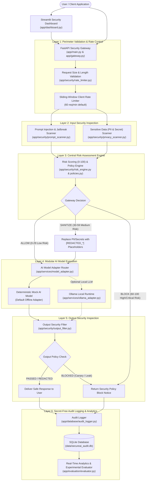

# 🏗️ System Architecture – SecureAI Gateway

## 1. Architectural Overview

**SecureAI Gateway** is an adaptive, multi-layered security firewall positioned between user interfaces and Generative AI models. Rather than relying on a single prompt filter or trusting the underlying LLM to enforce its own system prompt boundaries, SecureAI Gateway enforces defense-in-depth across the entire request-response lifecycle.

---

## 2. Component Responsibilities

| Module | File Path | Core Responsibility |
|---|---|---|
| **FastAPI Server** | `app/main.py` | Exposes REST endpoints for gateway execution, standalone scanners, audit log queries, policy updates, and health checks. |
| **Gateway Orchestrator** | `app/gateway.py` | Coordinates the 6-layer pipeline (`process_gateway_request`) and provides the unprotected baseline runner (`process_unprotected_baseline`) for experimental comparison. |
| **Prompt Injection Scanner** | `app/security/prompt_scanner.py` | Configurable regex and heuristic rule engine with dynamic rule registration, Base64 obfuscation decoding, and defensive/educational context dampening. |
| **Privacy Scanner** | `app/security/privacy_scanner.py` | Detects and redacts emails, Indian/international phone numbers, PAN/Aadhaar/SSN identifiers, IPv4 addresses, API keys, and passwords. |
| **Risk Assessment Engine** | `app/security/risk_engine.py` | Combines weighted scanner outputs into a 0–100 risk score (`Low Risk`, `Medium Risk`, `High Risk`, `Critical Risk`) and determines `ALLOW`, `SANITIZE`, or `BLOCK`. |
| **Output Security Filter** | `app/security/output_filter.py` | Scans model outputs for leaked system instructions, synthetic canary markers, residual PII, and unsafe exploit payloads. |
| **Rate Limiter & Validator** | `app/security/rate_limiter.py` | Enforces payload byte limits, character length bounds, null-byte checks, sliding-window rate limits, and `X-API-Key` authentication. |
| **AI Model Adapters** | `app/services/model_adapter.py`, `ollama_adapter.py` | Provides an offline deterministic Mock AI Model alongside an optional local Ollama LLM connector. |
| **Audit Logger & DB** | `app/database/db.py`, `audit_logger.py` | Persists redacted security events and active policy state in SQLite; supports date/risk/category filtering and summary statistics. |
| **Evaluation Engine** | `app/evaluation/attack_dataset.py`, `evaluator.py`, `metrics.py` | Generates 450 synthetic test cases and runs Experiment A (Unprotected) vs. Experiment B (Protected), producing CSV, JSON, HTML charts, and Markdown reports. |
| **Streamlit Dashboard** | `app/dashboard.py` | Interactive 6-section Security Operations Center dashboard connected to live gateway and SQLite data. |
