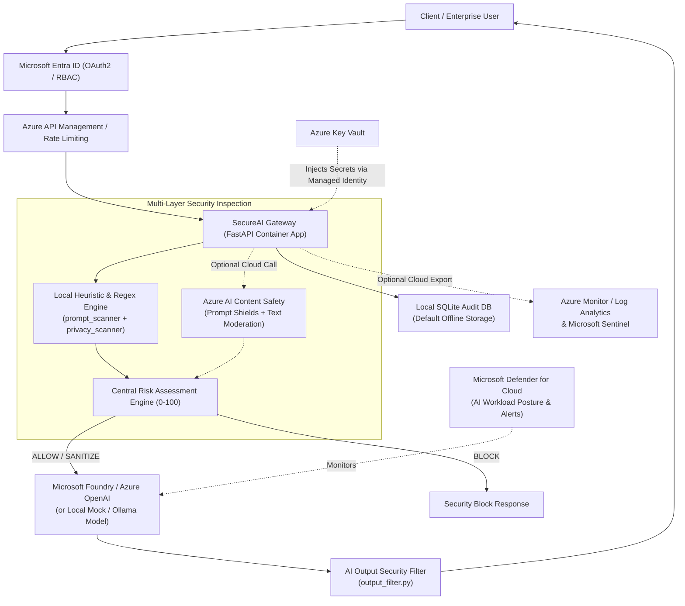

# ☁️ Microsoft Azure Alignment & Cloud Integration Guide

**Document Scope:** Phase 12 – Alignment with Microsoft's *Secure AI Solutions in the Cloud* Applied Skills Credential.

> **Important Transparency Note:**  
> **SecureAI Gateway** is designed to operate 100% locally on Windows using free, open-source Python components without requiring paid APIs, Azure subscriptions, or cloud credits. This document provides an architectural blueprint and service-to-feature mapping illustrating how the local gateway components correspond to—and can be integrated with—Microsoft Azure's enterprise AI security ecosystem when deployed to the cloud. Local rules and SQLite telemetry do **not** represent live findings from Microsoft Defender for Cloud or Microsoft Foundry unless explicitly connected to an active Azure subscription.

---

## 1. Service-to-Feature Mapping

| SecureAI Gateway Component (Local Implementation) | Corresponding Microsoft Azure Service | Role in Cloud AI Security Architecture |
|---|---|---|
| **AI Model Adapter** (`app/services/model_adapter.py`, `ollama_adapter.py`) | **Microsoft Foundry (Azure AI Foundry) & Azure OpenAI Service** | Hosts enterprise foundation models with deployment governance, token quotas, and managed endpoints. |
| **Input & Output Security Scanners** (`prompt_scanner.py`, `output_filter.py`) | **Azure AI Content Safety (Prompt Shields & Groundedness Detection)** | Provides neural classifiers for user prompt attacks (jailbreaks), indirect document attacks, and harmful content categories (Hate, Violence, Self-Harm, Sexual). |
| **Sensitive Data Privacy Scanner** (`privacy_scanner.py`) | **Azure AI Language (PII Detection) & Microsoft Purview** | Identifies, classifies, and redacts sensitive PII/PHI and enforces enterprise data-loss prevention (DLP) policies. |
| **Risk Engine & Threat Monitoring** (`risk_engine.py`, `dashboard.py`) | **Microsoft Defender for Cloud (Defender for AI Services)** | Provides Cloud Security Posture Management (CSPM) and runtime threat protection alerts for suspicious AI workload activity. |
| **API Key Auth & Client Rate Limiting** (`rate_limiter.py`) | **Microsoft Entra ID & Azure API Management (APIM)** | Enforces OAuth 2.0 / OIDC token validation, Role-Based Access Control (RBAC), managed identities, and token-rate limits. |
| **SQLite Audit Logger & Analytics** (`db.py`, `audit_logger.py`) | **Azure Monitor, Log Analytics & Microsoft Sentinel** | Centralizes diagnostic logs (`SecureAIGateway_CL`), KQL queries, latency metrics, and SIEM incident correlation. |
| **Environment & Policy Configuration** (`config.py`, `policies.py`) | **Azure Key Vault & Azure App Configuration** | Stores API keys, certificates, and connection strings in hardware-backed (HSM) vaults with zero secrets in source code. |

---

## 2. Cloud-Aligned Reference Architecture



---

## 3. Detailed Alignment by Microsoft Service

### 3.1 Microsoft Foundry (Azure AI Foundry)
- **Model Integration:** Our modular `ModelServiceRouter` (`app/services/model_adapter.py`) separates security inspection from model invocation. Switching from the local `MockAIModelAdapter` or `OllamaModelAdapter` to a Microsoft Foundry deployed model requires only adding an adapter method that calls the Azure OpenAI Chat Completions REST endpoint.
- **Defense-in-Depth Guardrails:** In production, SecureAI Gateway acts as a fast pre-filter (< 2 ms local latency) that blocks deterministic injections and redacts organization-specific PII *before* tokens are billed by Microsoft Foundry, while Microsoft Foundry's native Content Filters provide secondary neural guardrails.
- **Model Deployment Considerations:** Deployments in Microsoft Foundry should enforce version pinning, private endpoints (Azure Private Link), and separate capacity quotas per environment.

### 3.2 Microsoft Defender for Cloud
- **Cloud Security Posture Management (CSPM):** Defender for Cloud continuously assesses AI deployments for misconfigurations (e.g., disabled network restrictions, overly permissive IAM roles, unencrypted storage).
- **Threat Protection for AI Workloads:** Defender for AI Services monitors runtime signals for anomalous data exfiltration and jailbreak bursts. Locally, `SecureAI Gateway` surfaces analogous high/critical-risk request counters and prompt-injection attempt metrics in the **Threat Monitoring** tab of `app/dashboard.py`.

### 3.3 Microsoft Entra ID
- **Authentication & Identity Management:** Locally, `SecureAI Gateway` protects administrative policy endpoints (`/api/v1/policy`, `/api/v1/rules`, `/api/v1/audit/events`) via an `X-API-Key` header (`app/security/rate_limiter.py`).
- **Cloud Upgrade Path:** In Azure, static API keys are replaced with **Microsoft Entra ID** JWT Bearer tokens and **Managed Identities**:
  - Users authenticate via Entra ID App Registrations (`Gateway.ReadWrite`, `SecurityAdmin.ManagePolicy` app roles).
  - The FastAPI gateway uses `DefaultAzureCredential` to authenticate to Microsoft Foundry and Azure Key Vault without storing any credentials.

### 3.4 Azure Monitor & Log Analytics
- **Diagnostics & Observability:** Every event stored in `security_audit_logs` (`request_id`, `timestamp`, `redacted_prompt`, `risk_score`, `risk_level`, `threat_category`, `gateway_decision`, `processing_latency_ms`) maps directly to a custom Log Analytics table (`SecureAIGatewayAudit_CL`) via the Azure Monitor Ingestion API.
- **Privacy Compliance in Logs:** Both local SQLite logging and cloud log ingestion enforce strict PII/secret redaction prior to persistence so that raw credentials or personal data never enter diagnostic logs.

### 3.5 Azure Key Vault
- **Secrets Management:** Locally, configuration defaults live in `app/config.py` and environment variables (`SECUREAI_ADMIN_TOKEN`), with zero real secrets committed to Git.
- **Cloud Upgrade Path:** In Azure, all sensitive values (signing keys, external API tokens, database encryption keys) are stored in **Azure Key Vault** with RBAC access policies, rotation schedules, and audit logging enabled.

---

## 4. Local vs. Azure Subscription Feature Matrix

| Capability | Currently Implemented Locally (Free / Offline) | Requires Active Azure Subscription |
|---|---|---|
| Prompt Injection & Jailbreak Detection | ✅ Yes (`app/security/prompt_scanner.py`) | Neural Prompt Shields API (`Azure AI Content Safety`) |
| Sensitive PII & Secret Redaction | ✅ Yes (`app/security/privacy_scanner.py`) | Managed NER PII service (`Azure AI Language`) |
| Risk Scoring & Adaptive Policy Engine | ✅ Yes (`app/security/risk_engine.py`, `policies.py`) | — |
| AI Output Security Filtering | ✅ Yes (`app/security/output_filter.py`) | Groundedness & Protected Material API |
| Rate Limiting & Request Validation | ✅ Yes (`app/security/rate_limiter.py`) | Distributed multi-region throttling (`Azure APIM`) |
| Security Audit Logging & Analytics | ✅ Yes (`SQLite` + `Streamlit` + `Plotly`) | `Azure Monitor` / `Microsoft Sentinel` KQL Workbooks |
| Cloud Security Posture & IAM | Local API token auth | `Microsoft Defender for Cloud` & `Microsoft Entra ID` |

---

## 5. Integration Requirements, Configuration Steps & Cost Considerations

### Prerequisites for Optional Cloud Deployment
1. An active Azure Subscription with permissions to create a Resource Group.
2. Provisioned resources (optional):
   - **Azure AI Content Safety** (Free tier `F0` supports 5,000 text records/month at $0 cost; Standard `S0` is pay-as-you-go).
   - **Azure Log Analytics Workspace** (First 5 GB/month ingestion is free).
   - **Azure Key Vault** (~$0.03 per 10,000 operations).

### Step-by-Step Configuration (When Connecting to Azure)
1. Retrieve endpoint and managed identity configuration from Azure Portal.
2. Export environment variables locally (never hardcode in source files):
   ```powershell
   $env:AZURE_CONTENT_SAFETY_ENDPOINT = "https://<your-resource>.cognitiveservices.azure.com/"
   $env:SECUREAI_ADMIN_TOKEN = "<your-keyvault-injected-token>"
   ```
3. Keep local heuristic and privacy scanners enabled as the **first line of defense** to minimize cloud API calls, latency, and metered billing costs.
